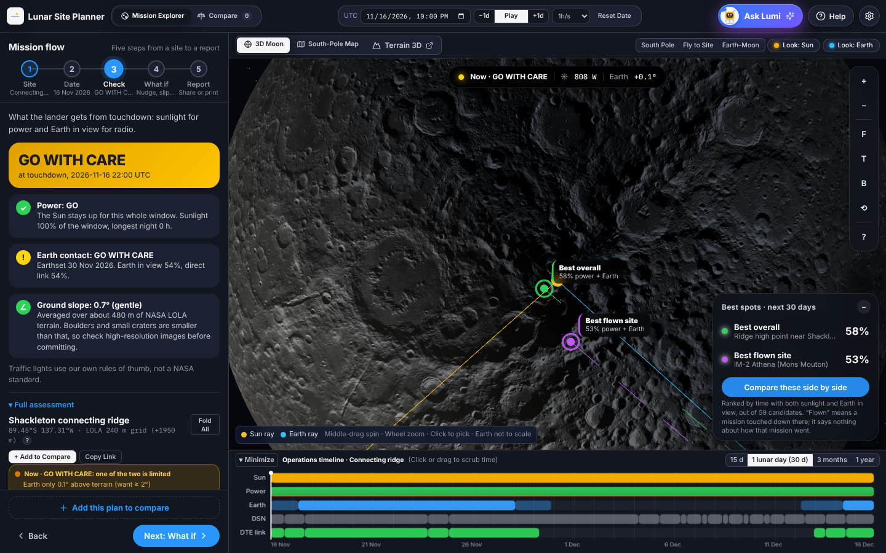
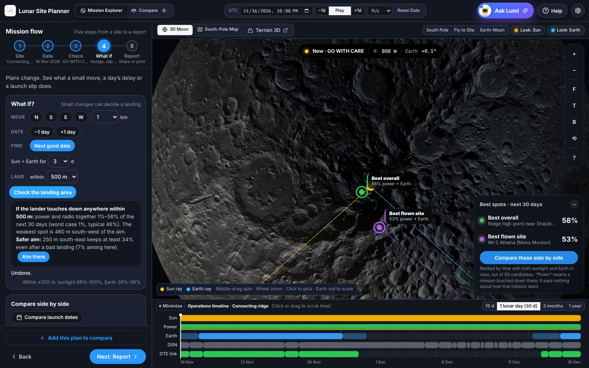
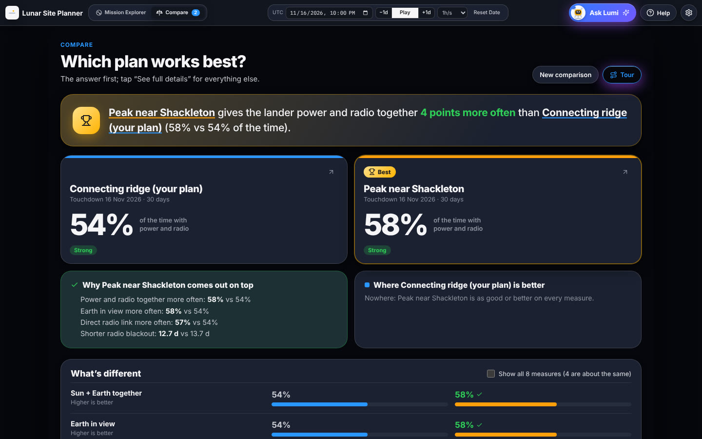
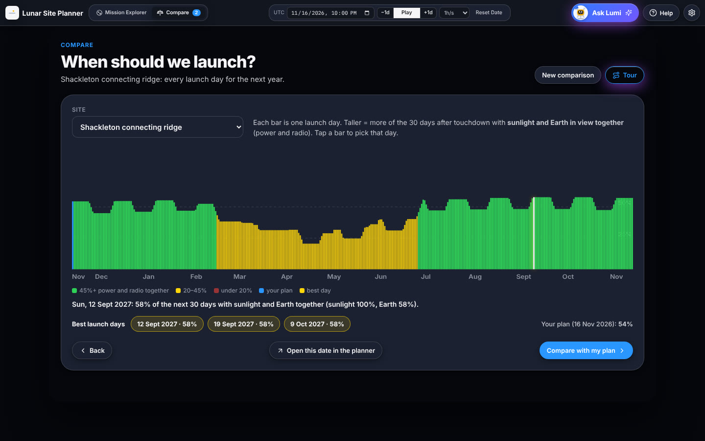
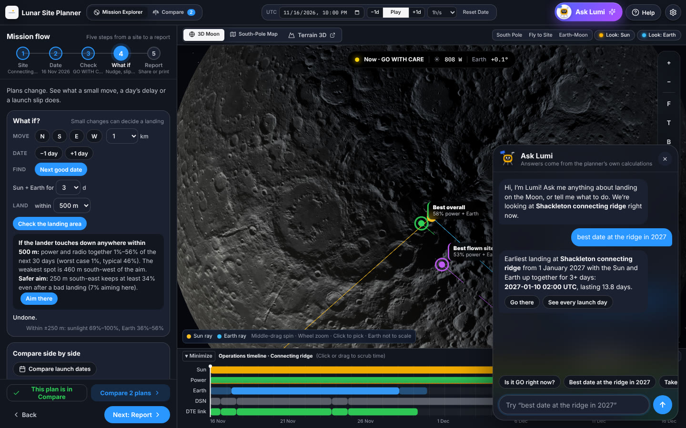
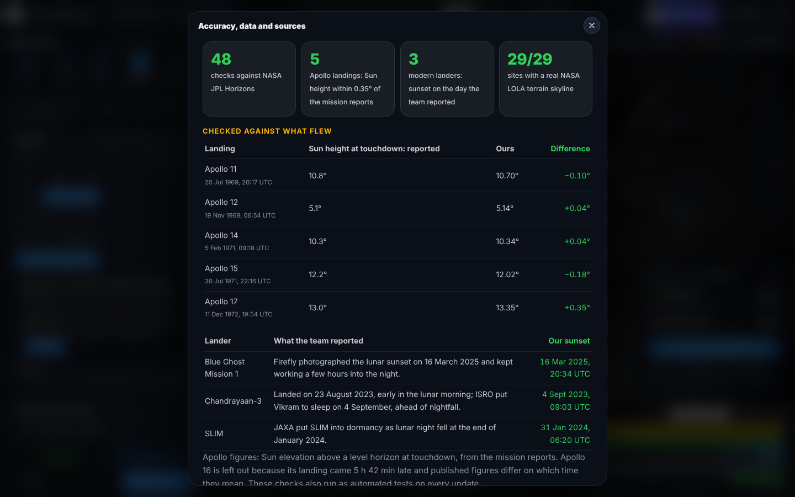

# Lunar Site Planner

**Where and when should we land on the Moon, so the lander has sunlight for power and Earth in view to call home?**

Lunar Site Planner answers that for any site and any date, against the real terrain skyline from NASA's LRO LOLA laser altimeter. It runs in any browser, on a phone too, with no install, no account and no API key.

**▶ Try it: [arairo.github.io/IMPROVED_lunarmoon-](https://arairo.github.io/IMPROVED_lunarmoon-/)** · [48-second promo](public/tutorial/lunar-site-planner-promo.mp4) · [2-minute tutorial](public/tutorial/pro-tutorial.mp4)

Team **Dell Monitors**, Kuala Lumpur · NASA Space Apps Challenge 2026: *Lunar Landing Site Navigator*.
The version submitted during the event stays frozen at [Arairo/NASA_lunarmoon-](https://github.com/Arairo/NASA_lunarmoon-); this repo is where we kept going. The full change log is in [IMPROVEMENTS.md](IMPROVEMENTS.md).



## The problem, in one example

At the lunar south pole the Sun skims the horizon, so a ridge a few hundred metres high can hide it for days. On the Shackleton connecting ridge, from 16 Nov 2026:

| | On the ridge | 1 km north | Anywhere within 500 m (landing error) |
|---|---|---|---|
| Sunlight, next 30 days | **100 %** | **56 %** | – |
| Earth in view, next 30 days | 47 % | **0 %** | – |
| Sunlight and Earth together | 47 % | 0 % | **0 % to 54 %** (typical 36 %) |

One kilometre, or one bad landing, can decide a mission. Lunar Site Planner shows that in a click, in plain words, for planners, teachers and the public alike.

## Two ways in

**Beginner: "Mission: Land on the Moon"**: six short chapters with Lumi, our guide. Find the sunny spot (a guessing game on the real south-pole lighting map), pick a day from a Moon "forecast", choose a route and watch the launch and landing in 3D, survive 30 days with power and radio meters, and earn a printable mission badge with up to three stars. Read-aloud, one decision per screen, works on a phone.

**Professional**: a five-step mission flow with the 3D Moon in the middle. **Map layers** colour the whole Moon by sunlight, Earth in view, Sun + Earth together, never-sunlit areas, height or slope, with a live readout under the pointer. The sunlight and Earth layers work **now** (they follow the timeline, so pressing Play sweeps the shadows round the pole), **for your 30 days**, or **for the whole of 2027**.

1. **Site**: Apollo, CLPS (IM-1, IM-2, Blue Ghost), Chandrayaan-3, Chang'e, SLIM, computed best-lit ridges, coordinates, or a click anywhere on the Moon. The best spot for the next 30 days is found for you.
2. **Date**: a month calendar coloured for your site (green = sunlight and Earth together for 3+ days), or "Find the next good date".
3. **Check**: GO / GO WITH CARE / NO GO at touchdown, with sunset and Earthset, power, battery, the direct-to-Earth link and the ground slope.
4. **What if**: move the site 0.25–10 km, slip the date, or **check the landing area**: if the lander touches down anywhere within 100 m to 2 km, how bad can it get, and where is a **safer place to aim**?
5. **Report**: one page to print or save as PDF, a share link, or a JSON decision summary.



## Flight: from the launch pad to touchdown

The **Flight** view works backwards from your touchdown time: when to launch, which route, every burn and how much fuel the lander needs. Pick **Direct** (3–5 days, like Apollo 11 and IM-1), **Phasing loops** (~40 days, like Chandrayaan-3 and Blue Ghost 1) or **Low-energy** (~4 months, like SLIM), compare all three side by side, and watch the flight in 3D: Earth, the moving Moon, the path coloured by phase and the descent onto your site. It also checks the touchdown itself: is the Sun at a good angle for the landing cameras, is there power on arrival, and can Earth follow the descent by radio.

It is a two-body ("patched conics") planning model, good to hours and tens of m/s. The automated tests check it against Apollo 11's burns (leaving Earth orbit 3.16 vs 3.18 km/s flown; braking into lunar orbit 0.93 vs 0.94 km/s) and five flown timelines.

## Compare, one question at a time

Pick a question (two places, launch dates, or your plan vs the best spot) and get one answer: a verdict sentence, why the winner wins, and only the measures that actually differ. The launch-date view puts every day of the next year on one chart, like a flight-price graph.

| | |
|---|---|
|  |  |

## Ask Lumi

Type what you want: "best date at the ridge in 2027", "compare ridge and IM-2", "move 1 km north", "can I see Earth from Chang'e 4?", "what is libration?". Lumi is rule-based and runs offline: it turns your words into planner actions and reads every number from the same engine you see on screen, so it cannot make a figure up.



## Artemis III regions, exports and the API

- **NASA's nine Artemis III candidate regions** (Oct 2024) are in the site list
  under *Artemis III* and outlined on the 3D Moon. The outlines come from the
  USGS release (McClernan 2024, doi:10.5066/P1MEQ6UK), which took them from LROC
  QuickMap. Each region centre has 20 m terrain; click inside an outline to test
  other spots.
- **Exports:** the Report step downloads the decision summary (JSON) and the
  full time series (CSV). GeoTIFF lighting maps in the IAU Moon projections NASA
  PGDA uses are in `public/api/v1/maps`.
- **Public API:** static, read-only, CORS-open files on GitHub Pages: sites,
  region outlines, day-by-day 2027 tables per site, the maps, and the engine as
  an ES module you can import. See [docs/API.md](docs/API.md).

## Why you can trust the numbers

Everything below is in the app under **Help → Accuracy, data and sources**, written up with an error budget in [docs/VALIDATION.md](docs/VALIDATION.md), and the checks run as automated tests on every update.

- **Checked against NASA JPL Horizons**: 154 Sun and Earth positions (11 sites including both poles' surroundings, the far side and the western limb × 7 dates from 1969 to 2030): worst elevation difference **0.007°**, median 0.001° (the Sun's disk is 0.53° wide). Re-run any time with the *Validate against JPL Horizons* workflow; the scoreboard is published in the app.
- **Checked against what flew**: the Sun's height at the Apollo 11, 12, 14, 15 and 17 touchdowns is within **0.35°** of the mission reports, and our sunsets at Blue Ghost Mission 1, Chandrayaan-3 and SLIM fall on the days their teams reported.
- **Checked against NASA Goddard's lighting maps**: our south-pole sunlight map matches NASA PGDA's average-illumination map with a correlation of **0.92** (Earth in view: **0.975**), average difference about 4 points, across 24,000 cells. At the Shackleton connecting ridge, 20 m terrain gives 64 % sunlight for 2027 (Sun's centre up); NASA's map, which counts a partly visible Sun over many years, says 68 %.
- **Real terrain at every site**: NASA LOLA **20 m** terrain (PGDA, Barker et al. 2023) around the main south-polar sites, 240 m and 1 km grids around the pole, and the global LDEM_16 map (~1.9 km) everywhere else, ray-cast 300 km out in every direction. Each 20 m tile is checked against our 240 m grid before use (2–4 m average difference). A test checks the horizon over a synthetic mountain against the exact geometric answer.
- **One engine**: all the maths is in [`src/core/`](src/core): pure functions with tests. The 3D Moon, maps, charts, Lumi and Compare only show what `core/` returns.
- **Known limits are stated**: terrain detail (boulders and the lander footprint are smaller than even a 20 m cell), the slope is a ~0.5 km average, and the GO / NO GO lights are our own rules of thumb, not a NASA standard.



## NASA and other data

- **NASA LRO LOLA**: south-polar elevation grids (240 m, 1 km) built from LOLA laser altimetry, and the global elevation map LDEM_16 (PDS Geosciences Node), built by the *Build global terrain* workflow.
- **NASA GSFC Planetary Geodesy Data Archive (PGDA)**: LOLA 20 m south-pole terrain (LDEM_80S_20MPP_ADJ) and the lunar polar illumination maps used as an independent check, by the *Add 20 m terrain and check against NASA PGDA* workflow.
- **NASA LRO LROC WAC** global mosaic for the Moon imagery; **NASA Blue Marble** for Earth.
- **NASA Deep Space Network** station locations for the direct-to-Earth link.
- **NASA JPL Horizons** as the independent check.
- Sun and Earth positions: [astronomy-engine](https://github.com/cosinekitty/astronomy) (MIT) with the IAU lunar rotation model.
- Landing-site positions: NSSDCA, LROC, and the mission teams (ISRO, JAXA, CNSA, Intuitive Machines, Firefly).

## How we used AI

We built the app with Claude Code (Anthropic) as a coding assistant: it wrote most of the code, tests and text, and we reviewed and tested every change in the browser and against NASA tools. The tutorial narration is AI-generated (Kokoro text-to-speech) and the promo's music is synthesised in code; both videos carry an "SI-assisted" label. Lumi, the in-app assistant, is not an AI model: it is a set of rules that runs in your browser. No NASA logos or branding are used.

## Run it yourself

Needs Node 22. All data is committed, so a fresh clone works offline.

```bash
npm ci
npm run dev      # http://localhost:5174 (this computer only; add -- --host to test on a phone)
npm test         # unit, JPL Horizons and flown-mission tests
npm run build    # production build into dist/
npx vite preview --port 4174 & npm run test:smoke   # core journeys in a real browser (needs Playwright)
node tools/build_manifest.mjs   # after changing any file in public/data (checksums)
```

GitHub Actions (Actions tab):
- **Test and deploy to GitHub Pages**: tests every push and pull request; publishes only from `main`, and after a data workflow only if that run succeeded. See [SECURITY.md](SECURITY.md).
- **Validate against JPL Horizons**: compares 154 positions and publishes the scoreboard into the app.
- **Build global terrain**: downloads LOLA LDEM_16, packs it and rebuilds every site's skyline.
- **Add 20 m terrain and check against NASA PGDA**: reads the 20 m tiles and NASA's lighting maps, checks them and publishes the comparison into the app.

## Repository layout

```
index.html / planner.html   the app / the Cesium "Terrain 3D" view
src/core/                   the science: ephemeris, terrain horizons (polar + global), power,
                            comms, analysis, planning (nudge, find a date, calendar, launch-date
                            curve, landing dispersion, robust aim), flown-mission checks
src/experience/             intro, Beginner walk, the five-step flow, Ask Lumi, tours, menus
src/ui/                     Compare (question-first flow + full details), timeline, maps
src/scene/                  the Three.js Moon
public/data/                LOLA grids, global terrain, imagery, validation scoreboard
tools/                      data builders, Horizons validation, video pipeline (tools/video)
test/                       automated tests
```

## How to cite

Rasyid, A. (2026). *Lunar Site Planner: when a Moon lander gets sunlight and Earth contact* (Version 1.0.0) [Computer software]. https://github.com/Arairo/IMPROVED_lunarmoon-

GitHub's "Cite this repository" button gives the same in other formats (from `CITATION.cff`). A DOI will be added here once the release is archived on Zenodo.

## Team Dell Monitors

Built for the NASA Space Apps Challenge 2026, Kuala Lumpur. Developed and maintained by Ammar Rasyid bin Remy Azrai (Universiti Tenaga Nasional), with Ahmad Ibrahim Shahmi, Pratyush Kumar Biswal, Muhammad Nawfal bin Khairul Azlan and Kevin Yanlin Li Li. Software developed with AI coding assistance.

Lunar data from NASA is in the public domain. This is not a NASA product and is not endorsed by NASA.
